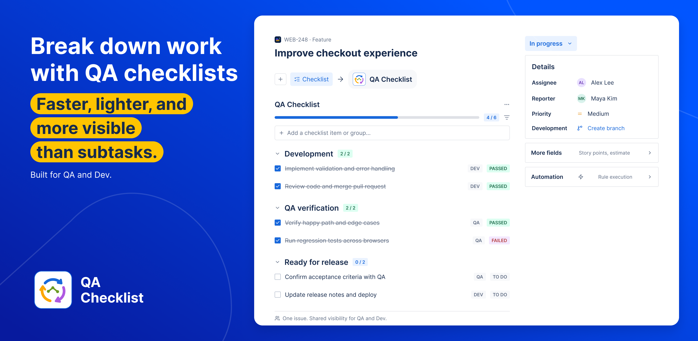
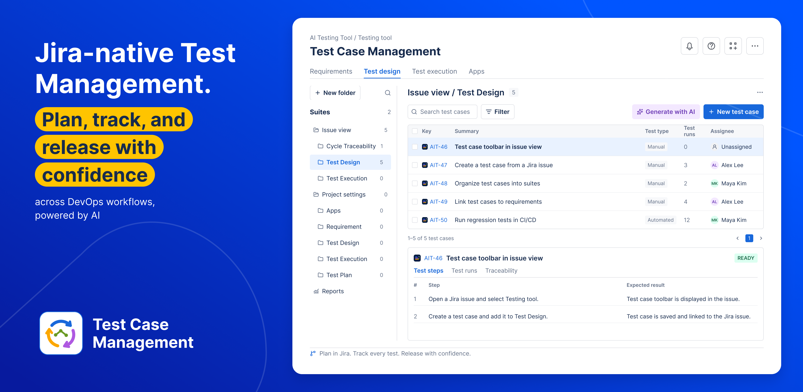
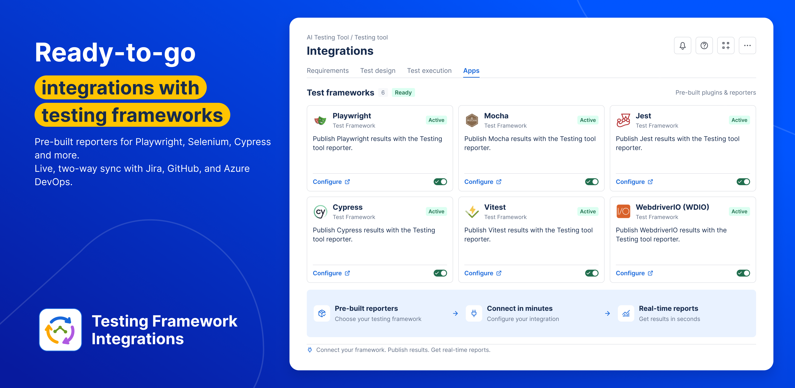

This guide is the knowledge base for **Testing tool**. Publish it to Confluence and attach the folder as knowledge on **Testing tool** so people asking “how do I manage tests?” land on the right section.

## Highlights

| QA Checklist | Test Case Management | Testing framework integrations |
| :---: | :---: | :---: |
|  |  |  |
| **[See coverage](./work-in-jira/see-coverage.md)** — shared checklist for QA and Dev on the issue. | **[Work in Jira](./work-in-jira/index.md)** — plan, track, and release with requirements, design, and cycles. | **[Publish from a framework](./settings-and-integrations/publish-results-from-a-test-framework.md)** — pre-built reporters; CI results land in Jira. |

## How this guide is organized

Pages are nested under four section hubs. **Start here**, **Glossary**, and **Troubleshooting** stay at the root so Testing tool and first-time readers find them immediately.

```text
Testing tool
├── Start here                 ← you are here
├── Set up Testing tool
├── Ask Testing tool
├── Work in Jira
├── Settings and integrations
├── Troubleshooting
└── Glossary
```

## Four paths

1. **[Set up Testing tool](./setup/index.md)** — what the product is, install, TMS-ready issue types, permissions and Rovo credits
2. **[Ask Testing tool](./ask-testing-tool/index.md)** — find and open the Rovo agent
3. **[Work in Jira](./work-in-jira/index.md)** — requirements, design, suites, cycles, Test Pad, issue panels, coverage, Excel
4. **[Settings and integrations](./settings-and-integrations/index.md)** — Apps catalog, ingest, CI push notifications, reporters, Cursor / Copilot / Claude

Stuck? **[Troubleshooting](./troubleshooting.md)**. Names? **[Glossary](./glossary.md)**.

## If you have two minutes

1. [What is Testing tool](./setup/what-is-testing-tool.md)
2. [Find and open Testing tool](./ask-testing-tool/find-and-open.md)
3. [Glossary](./glossary.md)

## Ask Testing tool these after you attach this folder

- What is Testing tool?
- How do I make a project TMS-ready?
- How do I open Testing tool?
- How do I run a test cycle?
- How do I connect CI ingest?
- How do I watch CI push notifications?
- How do I add a README sync status badge?
- Does turning an app Active install the agent?
- What is Manual vs Automated Test type?

Pass: the answer uses **Testing tool**, cites these pages, and does not invent a different product.

## FAQ

**Who is this for?**  
QA engineers, PMs, and anyone using Testing tool on a site where this app is installed.

**Is this the same as the Jira app?**  
Yes. The project hub and the Rovo agent are the same app (Forge name: AI Testing Tool). Chat picker label: **Testing Agent**.
