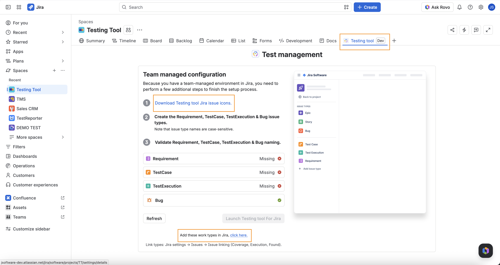
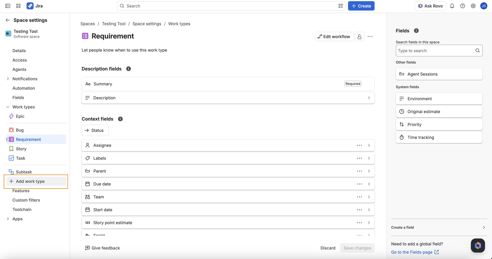
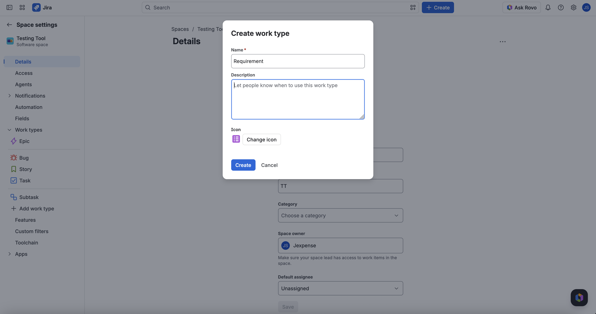
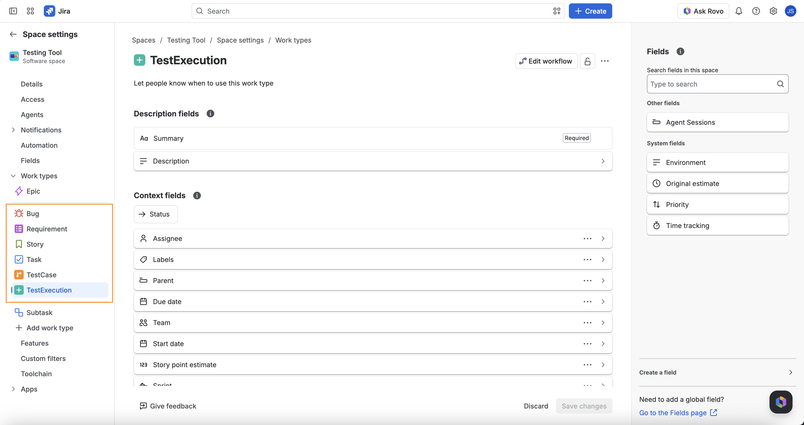

A project is TMS-ready when it has four Jira issue types named exactly **Requirement**, **TestCase**, **TestExecution**, and **Bug**, and the site has three issue link types named **Coverage**, **Execution**, and **Found**. Until those exist, Testing tool shows onboarding and the agent cannot create TestCases.

Issue type names are **case-sensitive**. `Testcase` or `Test Case` will show as **Missing**.

## What you will see

Open the project **Testing tool** page. If setup is incomplete, onboarding titled **Team managed configuration** lists each work type (**Requirement**, **TestCase**, **TestExecution**, **Bug**) as ready or **Missing**. Link types are not rows in that list — they are called out in the footer, and **Launch** stays disabled until both work types and link types are ready.

You need permission to add issue types in that project (project admin, or a Jira admin who can edit the issue type scheme). Creating missing link types on **Refresh** needs site configuration permission (`manage:jira-configuration`).

## Steps

1. Open **Testing tool** for the project.
2. Click **Download Testing tool Jira issue icons** if you want the official icons when you create the types.
3. Open project settings → **Work types** (use **Add these work types in Jira, click here** at the bottom of onboarding).
4. Choose **+ Add work type** and create each missing type with these exact names:
   - Requirement
   - TestCase
   - TestExecution
   - Bug

5. Add them to this project (team-managed: create in the project; company-managed: add them to the project's issue type scheme). When all four exist in the project, Work types looks like this:

6. Confirm site link types **Coverage**, **Execution**, and **Found** (Jira settings → Issues → Issue linking), or click **Refresh** so the app can create any that are missing.
7. Return to Testing tool and click **Refresh**.
8. When every work-type row shows ready (check) and **Launch Testing tool For Jira** is enabled, click it.

Link types are configured under **Issue linking**. Where the app can provision or attach the named types for you, use that in-app action, then **Refresh**. You do not need a full browser reload if Refresh succeeds.

### Link type phrases

| Name      | Outward        | Inward       |
| --------- | -------------- | ------------ |
| Coverage  | is covered by  | covers       |
| Execution | is executed as | executes     |
| Found     | found          | was found by |

## After it is ready

- Requirements, Test design, and Test execution are usable.
- Testing tool can create TestCases in this project (you still confirm each write in chat).
- If Testing tool still refuses create, you may lack **Create issues** on the project — see [Permissions, credits, and limits](./permissions-credits-limits.md).

## FAQ

**Why does Refresh still say Missing?**  
The type name does not match exactly, the type is not on this project's scheme, or you refreshed before Jira finished saving. Check the name, then Refresh again.

**Why is Launch still disabled when every work type shows ready?**  
A required link type (**Coverage**, **Execution**, or **Found**) is still missing on the site, or Refresh could not create it (needs `manage:jira-configuration`). Fix Issue linking, then Refresh again.

**Can I reuse an existing Bug type?**  
Yes, if it is named exactly **Bug** and it is available in this project.

**Do I do this on every project?**  
Issue types are per project. Link types are site-wide — once Coverage / Execution / Found exist on the site, every project can use them.

**Will Testing tool set this up for me?**  
No. It will fail closed and point you at Apps / this setup. An admin must add the work types. Link types may be created automatically on Refresh when the app has configuration permission.

## Related

- [Install and open Testing tool](./install-and-open.md)
- [Permissions, credits, and limits](./permissions-credits-limits.md)
- [Glossary](../glossary.md)
- [Start here](../start-here.md)
