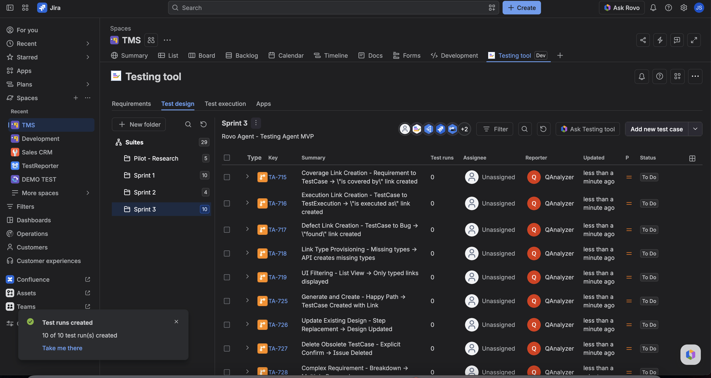

A **TestCase** holds the **design**: summary, preconditions, postconditions, and steps (action, optional data, expected result). You edit that design in **Test design** or on the TestCase issue panel — not in Test Pad.

Viewing design does not write anything. Saving steps updates the TestCase only. It does not change past TestExecution snapshots.

## Open Test design

1. Open **Testing tool** → **Test design**.
2. Select a suite, or work from **My test cases**.
3. Create a TestCase or open an existing one. Cases you create in the UI or Excel start as **Manual**.
4. Fill **Preconditions**, **Postconditions**, and steps. Each step has an action, optional data, and an expected result (attachments on expected result are supported).

The cases table shows a **Test type** column (**Manual** / **Automated**). Empty design shows placeholders — that is fine until you add steps.

**Automated** TestCases are view-only for design and steps (CI owns them). Switch **Test type** to **Manual** on the TestCase panel if you need to edit, or leave Automated cases to ingest.

## From a TestCase issue

On the TestCase issue, the **Test design** panel **Details** tab shows the same design. The **Test design** button jumps to this project view focused on that issue key — it does not create a new case. Use the header **Test type** control to set **Manual** or **Automated**.

## Fill steps with Testing tool

- Test design toolbar: **Ask Rovo**
- TestCase panel: **Fill steps with Rovo** (Manual only; same agent)

The agent proposes steps, then waits for you to confirm **update** (or **create** if this is a new case). See [Find and open Testing tool](../ask-testing-tool/find-and-open.md).

## Design vs a run

| Surface                  | What you edit                         |
| ------------------------ | ------------------------------------- |
| TestCase / Test design   | Design (source of truth for new runs) |
| TestExecution / Test Pad | Snapshot for **that** launch only     |

A new launch clones design onto a new TestExecution. Re-syncing the **same** launch reuses that TestExecution and does not re-clone (your in-progress actuals stay).

## FAQ

**Why did my run not pick up the new step I just added?**  
That run already has a snapshot. Start a **new** launch after you change design.

**Can I record pass/fail here?**  
No. Use Test Pad or the TestExecution (Manual). This page is design only.

**Why can't I edit this case?**  
**Test type** is **Automated**. Design is locked; use **CI/CD builds** on the issue for ingest history, or switch to **Manual**.

## Related

- [Start here](../start-here.md)
- [Glossary](../glossary.md)
