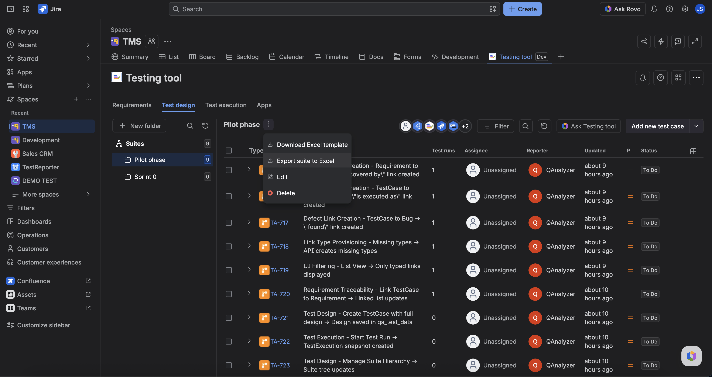
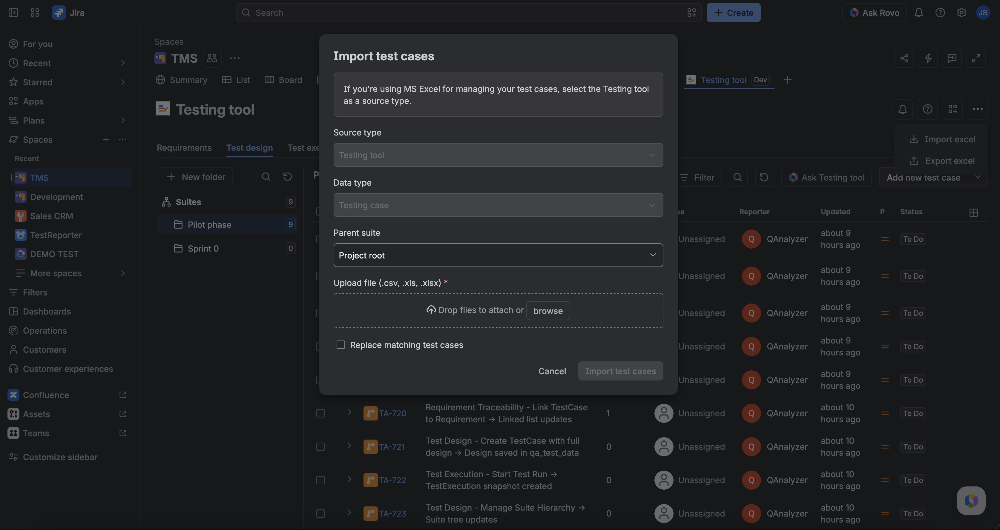

You can bulk create or update TestCases with Excel (`.xlsx`) from **Test design**. Download a template, export a suite or selection, edit offline, then import. The project must be [TMS-ready](../setup/make-project-tms-ready.md). Imported cases start as **Manual**.

Import checks that **you** can create and edit issues in the project before it writes. One spreadsheet **row** is one TestCase. Steps live in numbered multi-line **Action** / **Data** / **Expected Result** cells.

## Download and export

1. Open **Testing tool** → **Test design**.
2. **Download Excel template** for a blank sheet (or use **More** → **Export excel**).
3. **Export to Excel** for the current suite or selected cases. **Suite Path** on export is that suite’s path (not every membership).

Limits: export up to **100** TestCases per request. Over the limit returns an error.

## Import

1. Use **More** (⋯) on the Testing tool toolbar → **Import excel** (or the Test design import action).
2. Upload a valid `.xlsx`. All rows are validated before any Jira write.
3. Matching **issue key** updates that TestCase; new rows create TestCases.
4. After upload, watch the toolbar for **background job** progress, then read the per-row report (created/updated keys, warnings, errors).

Limits: import up to **50** TestCases (rows) per request; decoded file max **2 MiB**. Suite Path **adds** a link to the leaf suite and can create missing folders. It does not unlink or move in this version.

## Rules that surprise people

- Excel-created cases get sheet **Labels** only — no auto `qanalyzer` / `excel-import` labels.
- If a TestCase is CI-owned (`qa_link_source` = `auto`), import **skips summary** update but can still update design; you get a warning.
- Step attachments do not round-trip in the spreadsheet.

## FAQ

**Did import delete a case I omitted from the file?**  
No. Unrelated TestCases are left alone. Suite link is additive.

**Can Testing tool import Excel?**  
No. Use the Test design Import control. The agent drafts and writes one confirmed case at a time.

## Related

- [Design a TestCase](./design-a-testcase.md)
- [Organize suites](./organize-suites.md)
- [Start here](../start-here.md)
