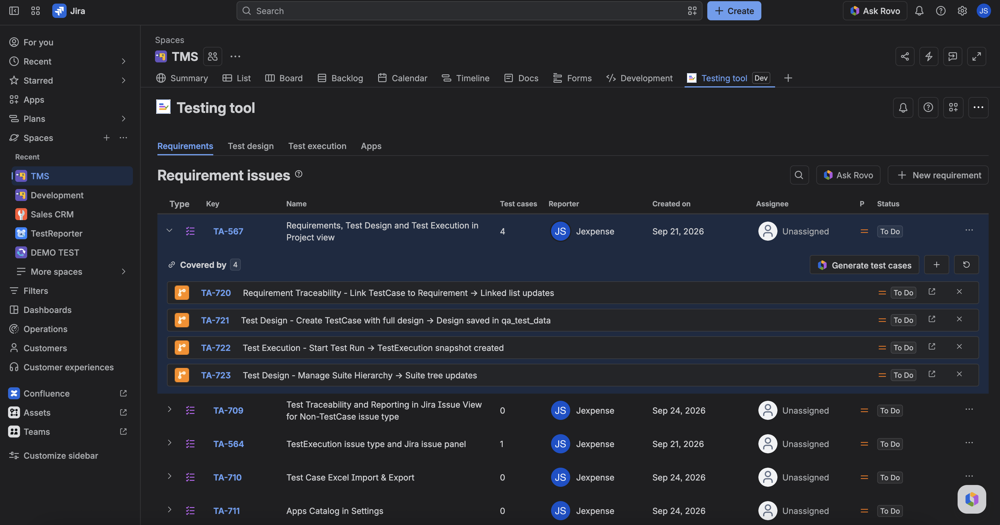

Requirements in Testing tool are Jira **Requirement** issues for this project. You list them, create them, and link or unlink TestCases so you can see what is covered.

The project must be [TMS-ready](../setup/make-project-tms-ready.md) or this view stays behind onboarding.

## Open the view

1. Open the project **Testing tool** page.
2. Open **Requirements**.
3. You see Requirement issues for this project. Empty state: **No Requirement issues yet** (or the same wording for that work type label).

## Create or open a Requirement

- Create a new Requirement from the view (Jira create is fine).
- Open an existing Requirement to edit summary or description in Jira.

## Link TestCases

1. Open a Requirement in the list.
2. **Link** one or more TestCases. The linked list shows at least the issue key (summary and status when available).
3. **Unlink** a TestCase when it no longer covers that need. Unlink does not delete the TestCase.

If nothing is linked, you see an empty “no test cases linked” state — that is not an error.

## Delete a TestCase

1. On a linked TestCase, click **Delete test case** (red cross icon).
2. In the confirm dialog, type **delete** to enable the **Delete** button — the dialog cannot confirm before that.
3. Confirm to permanently delete the TestCase from Jira. It disappears from the linked list, and its Coverage link to the Requirement goes with it.

The delete cascades: the TestCase's **test runs** (TestExecutions) are deleted too, and the TestCase is removed from its **suites**, **cycles** and **run history**. Deleting cannot be undone, and it also removes the TestCase from every other requirement. If you only want to stop tracking coverage, use **Unlink** instead. Requires the Jira **Delete Issues** permission — without it the dialog shows an error and nothing is deleted.

## Ask Testing tool from here

On the Requirements toolbar, click **Ask Rovo** (hidden if Rovo is off). The agent opens with this project named — give it a requirement or issue key for proposals. It will not write until you confirm. See [Find and open Testing tool](../ask-testing-tool/find-and-open.md).

## FAQ

**Can I use a Story instead of a Requirement?**  
Stories and epics get coverage on the **Cycle traceability** panel (link a test cycle). The Requirements view is for the **Requirement** work type. See [See coverage on a story or epic](./see-coverage.md).

**Does linking a TestCase create a cycle?**  
No. Linking traces design to a need. Cycles live under Test Execution.

## Related

- [Start here](../start-here.md)
- [Glossary](../glossary.md)
