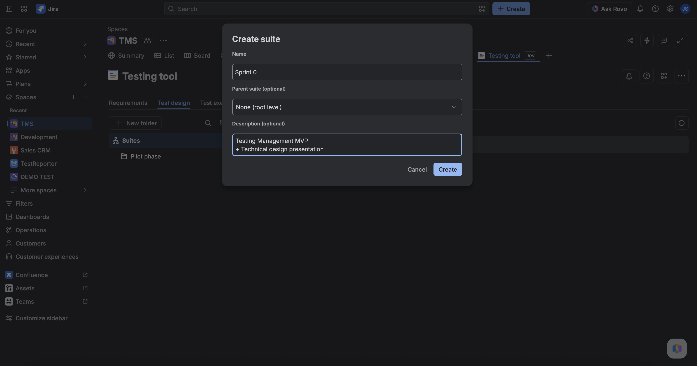

A **suite** is a folder in **Test Design** that groups TestCases. You create a tree of suites, then link or unlink cases so a cycle or reporter can pick up a set.

Suites are not Jira issue types. Removing a case from a suite does not delete the TestCase.

## Open suites

1. Open **Testing tool** → **Test design**.
2. Use the suite tree (empty state when none exist).
3. Create a suite, optionally nest it under a parent, and edit its name or description.

## Put TestCases in a suite

1. Open a suite.
2. **Link** TestCases into that suite.
3. **Unlink** a case when it no longer belongs there.

The same TestCase can be designed once and grouped for execution later. Adding it to a **test cycle** is a separate step under Test Execution.

## FAQ

**Is a suite the same as a test cycle?**  
No. A suite organizes design. A cycle is the set you intend to **run**. You often add suite members into a cycle, but they are different objects.

**If I delete a suite, do TestCases disappear?**  
The grouping is gone. The TestCase issues remain unless you delete those issues.

## Related

- [Start here](../start-here.md)
- [Glossary](../glossary.md)
