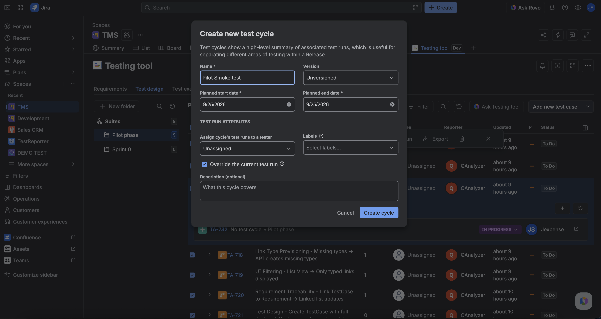
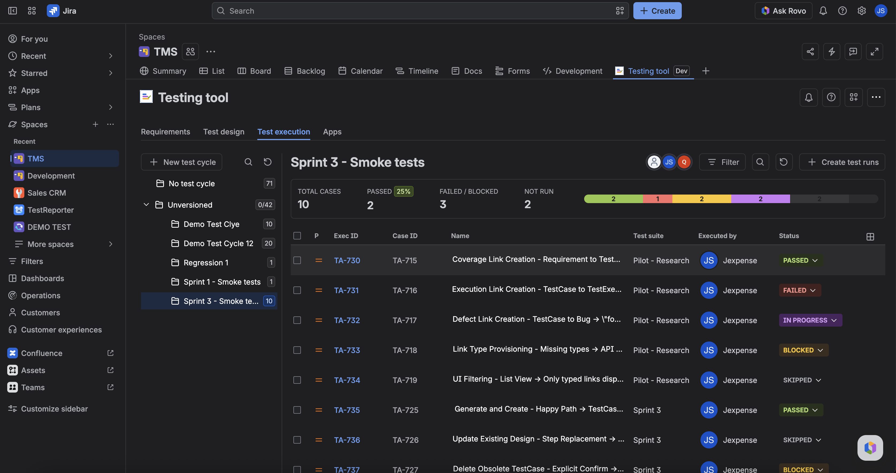

A **test cycle** (also called a plan) is the set of TestCases you intend to run together. You create the cycle, add or remove members, then **Create test runs** — each **new** launch creates a TestExecution per case.

Re-syncing the **same** launch reuses those TestExecutions. You do not get a second TE for the same case and launch.

## Open Test execution

1. Open **Testing tool** → **Test execution**.
2. Create or select a test cycle — or open **No test cycle** for runs that are not on a named cycle.
3. Add or remove TestCase members (named cycles only; **No test cycle** is system-managed).
4. Click **Create test runs** (or **Create test run** when you have a single case).

The header metrics card shows **TOTAL CASES**, **PASSED** (with pass-rate %), **FAILED / BLOCKED**, **NOT RUN**, and **AUTOMATED** (count with automated-coverage %). A status bar breaks down passed / failed / blocked / in progress / skipped / not run. A full report export is not in this product yet.

The runs table includes a **Test type** column (**Manual** / **Automated**). Automated rows lock status edits — CI owns those results.

## No test cycle

The sidebar always includes **No test cycle**. It holds TestExecutions that are not members of a named cycle — including unbound CI runs. Deleting a named cycle moves its runs here. You do not create or rename this system plan.

## From a TestCase

On the TestCase issue panel or Test design toolbar, **Create test run** starts a run for that case and surfaces the TestExecution in the runs list.

## CI launches

Pipeline uploads also create launches. After ingest sync, they show under Test execution (often under **No test cycle** until you add them to a named cycle). New TestCases created by ingest start as **Automated**. Same rule: new launch → new TestExecutions; same launch → reuse.

## Record results

Open **Test Pad** on a **Manual** TestExecution to set overall status and per-step actuals. That writes the snapshot only — not the TestCase design. Automated Pad is view-only. See [Use Test Pad](./use-test-pad.md).

## FAQ

**Why do I have two TestExecutions for one TestCase?**  
You started two **different** launches. Same launch never duplicates.

**Does creating a cycle change TestCase steps?**  
No. Design stays on the TestCase until you edit Test design.

**Where did my runs go after I deleted a cycle?**  
They moved to **No test cycle**.

## Related

- [Start here](../start-here.md)
- [Glossary](../glossary.md)
