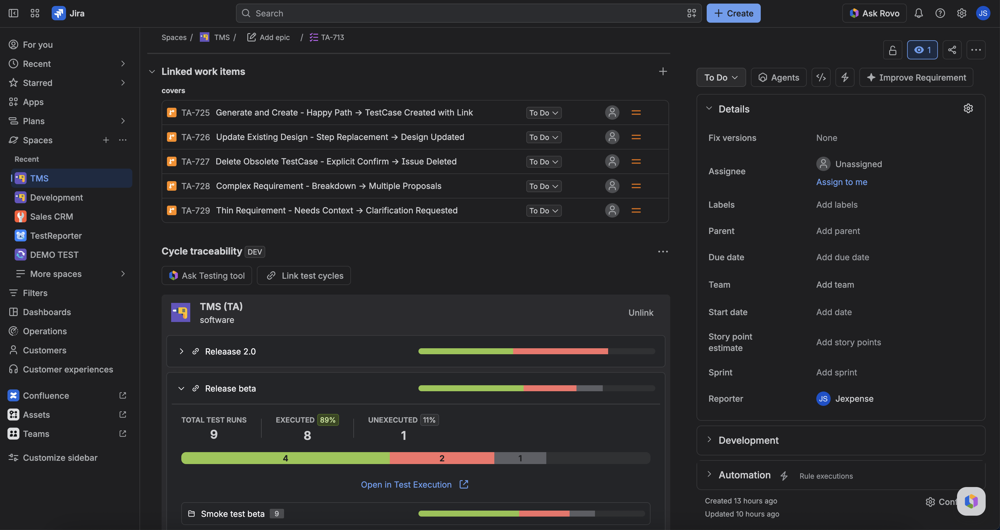

The **Cycle traceability** panel appears on Jira issues that are **not** a TestCase and **not** a TestExecution — stories, epics, and other work items. You link **test cycles** to the issue and see coverage for those cycles' TestCase members.

Coverage comes from linked cycles only (members + latest run status). It does not read TestCase design steps or Test Pad actuals as the coverage model.

On the same issue types you also get a **QA Checklist** panel: a **two-level** list of the TestCases linked to this issue (**any** link type), grouped by **Test Design suite**, with an overall **progress** bar and an **executed/total** count above the add trigger once the checklist has items. Each suite header shows the suite name, an executed/total badge and a collapse control (suites start **expanded** — collapse a suite to hide its TestCases, matching rows open themselves again when filters are applied); under it, each TestCase row has a **checkbox** plus its summary and the latest run status (the summary opens the TestCase). Click a row's checkbox to pick its result from a small popup that opens right under it — **Passed** / **Failed** for a TestCase without a result, **Unexecuted** to put an existing one back — and the pick is written straight away (no dialog to confirm) — while the write runs **and** until the list has read the new result back, that row's checkbox is replaced by a small **Saving result…** spinner. A tick updates the status of that TestCase's **latest TestExecution** in Jira, so the checklist, the TestExecution and the plan metrics stay in sync. A TestCase whose latest run has no TestExecution (it never ran, or its latest run came from a CI launch) picks the result first: the app's **Create test run** dialog opens next — the run is created for that TestCase (and its suite) straight from the checklist, the picked result is written to that new run, and the list refreshes once it is created. Use the **filter** icon next to the progress bar to open the **Filter checklist** popup — **Status** chips (Unexecuted / Passed / Failed, pick several at once), **Executed by** (a searchable picker showing each project user with their avatar — type a name to filter) and **Suite**; **Apply filters** commits them (the panel re-reads the checklist from the server with those filters), **Reset** clears the draft, and the trigger badge shows how many filter groups are on; the progress bar counts the rows currently listed (a filter combination that hides every row reads **0/0** and the panel then shows **No checklist items match these filters** with a **Reset filters** button, which clears the filters and brings the whole list back). TestCases without a suite appear directly below the last group. When that list is **empty** the panel shows a **No checklist items yet** state — choose **Add a checklist item** to open the inline add form. It has two sources: **Choose test case** (search the project, pick a result, then press **Add item** — this creates the real Jira issue link with the picked link type, so the row appears in the list after the panel re-reads the issue's links; TestCases that are already in the checklist are hidden from the results) or **Create test case** (fill in the title, **a suite** — required, marked with a red `*`, and **+ Create & add to checklist** stays disabled until one is picked; if the project has no suite yet the field becomes a **Create test suite** button that opens the **New test suite** dialog and selects what it creates — the project, pre/postconditions and steps (each step's **Action** and **Expected result** is edited inline — click the cell, type, then **Confirm**), then press **+ Create & add to checklist** — this creates a real TestCase with the project's mapped TestCase type, saves the pre/postconditions and steps on it, links it to the chosen suite and then links it to this issue, so it shows up in the checklist with its own key). On issues that are **not** a Requirement the form also shows a **Link type** picker (the site's link types, defaulting to the typed **Coverage** outward phrase); a Requirement always takes the Coverage link.

## Open the panel

1. Open a story, epic, or other non-TestCase / non-TestExecution issue.
2. Find the **Cycle traceability** panel (full view and issue modal). It loads on its own.
3. Click **Link test cycles** and choose one or more cycles. Links persist.
4. **Unlink** a cycle (or linked project group) when it should no longer count.

With links, you see at least **TOTAL TEST RUNS**, **EXECUTED**, and **UNEXECUTED** (plus the status bar the panel shows). With no links or no members: empty or zero — not an error.

## Ask Testing tool from a story

Use **Ask Testing tool** on this panel (hidden if Rovo is off) to draft TestCases from the issue. Creating cases is not the same as linking a cycle. After cases exist, add them to a cycle, then link that cycle here for coverage.

## FAQ

**Why is this panel missing on a TestCase?**  
TestCases use the **Test design** panel. TestExecutions use the **Test execution** panel.

**I linked a Requirement's TestCases. Why is coverage still zero?**  
This panel counts **cycles**, not requirement links. Create or pick a test cycle that contains those cases, then link that cycle.

## Related

- [Manage requirements](./manage-requirements.md)
- [Run a test cycle](./run-a-test-cycle.md)
- [Find and open Testing tool](../ask-testing-tool/find-and-open.md)
- [Start here](../start-here.md)
