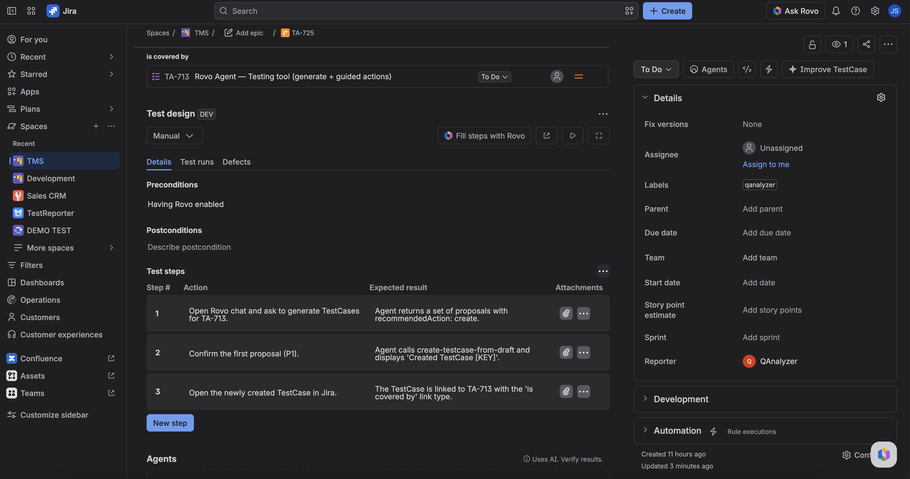

The **Test design** panel appears only on **TestCase** issues (full view and issue modal). Use it to see design, defects, runs, and (for Automated cases) CI ingest observations without leaving the issue.

It loads when you open the issue. You do not enable it. If load fails, use **Retry**.

## What you can do

- **Test type** — header control (**Manual** or **Automated**). Persists on the TestCase. New TestExecutions copy the type at create; existing runs keep the type they were created with.
- **Details** — preconditions, postconditions, steps (action, optional data, expected result). Empty design shows placeholders. Viewing does not write. **Automated** cases are view-only here — CI owns the design.
- **Test design** — opens the project Test design tab focused on this issue key. Does not create a new case.
- **Create test run** — creates a TestExecution for this TestCase and lists it under test runs.
- **Test runs** — executions (at least the TE key; name/status when available). Open a run to go to that TestExecution. Status edits are locked when the TestCase is **Automated**.
- **Defects** — linked bugs (key, summary, status) or an empty list.
- **CI/CD builds** — shown only when **Test type** is **Automated**. See below.
- **Fill steps with Rovo** — opens Testing tool to propose missing steps. Shown on **Manual** cases when Rovo is on; hidden for **Automated** or when Rovo is off.

Per-step pass/fail and actuals are **not** primary here. Those live on the TestExecution / Test Pad (Manual only).

## CI/CD builds tab

Appears after **Defects** when the TestCase is **Automated**. It lists **ingest run observations** for this TestCase across its TestExecutions (newest first, up to 50). Manual pad status changes are not included.

Each row can show:

| Column        | What it is                                                      |
| ------------- | --------------------------------------------------------------- |
| **CI build**  | Link to the CI job (label is the CI platform / name when known) |
| **Commit**    | Link to the commit (label is the author when known)             |
| **Branch**    | Git branch from the run meta, or the launch branch              |
| **Framework** | Test framework from the run meta (for example jest or vitest)   |
| **Status**    | Observation status (passed, failed, …)                          |
| **Ingested**  | Full date and time of the observation                           |
| **Duration**  | Run duration when recorded                                      |

Empty until CI has written history. The same launch or build may appear more than once when status changes (each observation is a row).

## FAQ

**Why do I not see this panel on a Story?**  
Wrong issue type. Stories get the **Cycle traceability** panel. TestExecutions get the **Test execution** panel.

**Why is there no CI/CD builds tab?**  
The tab appears only when **Test type** is **Automated**. Manual TestCases keep Details · Test runs · Defects.

**Why can't I edit steps or Fill steps with Rovo?**  
The TestCase is **Automated**. Switch to **Manual** if you need to edit design, or leave design to CI-owned cases.

**Did Fill steps with Rovo already save?**  
No. Confirm the update in chat first.

## Related

- [Design a TestCase](./design-a-testcase.md)
- [TestExecution issue panel](./testexecution-issue-panel.md)
- [Find and open Testing tool](../ask-testing-tool/find-and-open.md)
- [Start here](../start-here.md)
