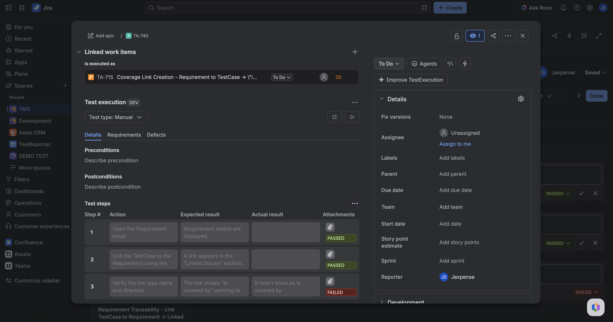

The **Test execution** panel appears only on **TestExecution** issues (full view and issue modal). It shows the run's status, Test type, which TestCase this run belongs to, and (for Automated runs) CI ingest history.

It loads when you open the issue. You do not enable it. If load fails, use **Retry**.

## What you see

- **Test type** badge (**Manual** or **Automated**) — read-only; copied from the TestCase when this run was created.
- **Test status** pill — the current execution status of this run. On **Manual** runs, click it to set **PASSED**, **FAILED**, **BLOCKED**, **SKIPPED**, **IN PROGRESS**, or **UNEXECUTED**. It shows **UNEXECUTED** while no result is stored. On **Automated** runs the pill is **read-only** — CI owns the result; use **CI/CD builds** for ingest history.
- **Open test case** / **Test pad** buttons.
- Linked **TestCase** access through **Open test case** — or no button when the run is not linked to a TestCase.
- Tabs: **Details** · **Requirements** · **Defects** · **CI/CD builds** (Automated only). Manual keeps the first three.
- **Step attachments** in **Details**: a paperclip with an evidence count on steps that have files from [Test Pad](./use-test-pad.md). Open it to see the run's evidence as cards — thumbnail (images), file name, size; click the name to open the file in Jira. Steps without evidence show no paperclip.

Changing **Test status** on a Manual run writes the same TMS execution status as [Test Pad](./use-test-pad.md) and the project **Test execution** table: it stores a new run-history entry for this TestExecution and leaves the step snapshot, its actual results, and the TestCase design untouched.

Step attachments in this panel are read-only and come from the step snapshot cloned when the run was created — the run's **actual-result** evidence, the same files you upload in Test Pad. Expected-result attachments from the TestCase design stay on the TestCase. Use Test Pad to add or remove evidence.

This panel is not required to edit per-step actuals. Use [Test Pad](./use-test-pad.md) for that. The TE already holds a step snapshot cloned when the execution was created.

## CI/CD builds tab

Appears after **Defects** when this TestExecution’s Test type is **Automated**. It lists **ingest run observations for this TestExecution only** (newest first, up to 50). Manual pad status changes are not included.

Each row can show:

| Column        | What it is                                                      |
| ------------- | --------------------------------------------------------------- |
| **CI build**  | Link to the CI job (label is the CI platform / name when known) |
| **Commit**    | Link to the commit (label is the author when known)             |
| **Branch**    | Git branch from the run meta, or the launch branch              |
| **Framework** | Test framework from the run meta (for example jest or vitest)   |
| **Status**    | Observation status (passed, failed, …)                          |
| **Ingested**  | Full date and time of the observation                           |
| **Duration**  | Run duration when recorded                                      |

Empty until CI has written history. The same launch or build may appear more than once when status changes (each observation is a row).

On an Automated **TestCase**, the same tab lists observations across all of that case’s TestExecutions — see [TestCase issue panel](./testcase-issue-panel.md).

## How a TestExecution is created

- **Create test run** / **Create test runs** in Testing tool or on a TestCase.
- CI ingest for a **new** launch (or reuse of the first TE for later CI launches). New TestCases created by ingest start as **Automated**; new TestExecutions copy the TestCase type at create.

Same launch re-sync reuses this issue and does **not** re-clone steps (your actuals stay). Re-sync also does not overwrite Test type.

## FAQ

**Why is there no Test design panel here?**  
This issue type is TestExecution. Open the linked TestCase for design.

**Why is there no CI/CD builds tab?**  
The tab appears only when **Test type** is **Automated**.

**Can I change this run's status?**  
On **Manual** runs, yes — use the **Test status** pill, Test Pad, or the project Test execution table. On **Automated** runs, no — the pill is read-only; CI owns the result. Results that CI ingest wrote stay in history — the pill always shows the latest entry.

**Why does the pill show UNEXECUTED?**  
No run-history entry with a status exists for this TestExecution yet. On a Manual run, pick a status to record one.

**Where do the step attachments in the panel come from?**  
From this run's Test Pad evidence (the step snapshot's actual-result attachments), shown as read-only cards. Files uploaded as expected-result attachments on the TestCase design do not appear here — open the TestCase for those.

## Related

- [Use Test Pad](./use-test-pad.md)
- [TestCase issue panel](./testcase-issue-panel.md)
- [Run a test cycle](./run-a-test-cycle.md)
- [Start here](../start-here.md)
