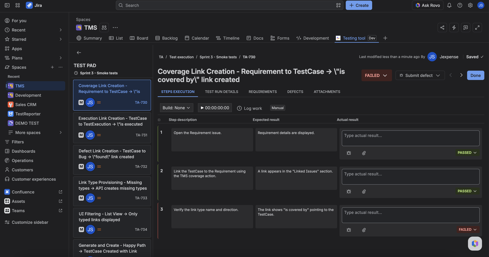

Test Pad is the step-by-step runner for **one TestExecution**. On **Manual** runs you record overall status and per-step actuals on that run's snapshot. You do not edit the TestCase design here.

**Automated** runs are view-only in Pad — CI owns the result. Testing tool will not mark steps passed or failed for you.

## Open Test Pad

1. Start or open a run from **Test execution** (**Create test runs**) or from a TestCase (**Create test run**).
2. Open the **TestExecution** issue, or open Pad from the cycle (**Test pad**, **View test pad**, or **Run selected tests**).
3. Confirm the **Manual** / **Automated** lozenge. Automated Pad stays view-only.
4. On Manual runs: set overall run status (for example Passed, Failed, Blocked, Skipped).
5. On Manual runs: for each step, set status and actual result (attachments on actuals when the UI offers them).

Pad tabs include **Steps execution**, **Test run details**, **Requirements**, **Defects**, and **Attachments**. Writes go only to that TestExecution. Callers must target an explicit TE key or (TestCase + launch). The app will not remap to a random TE for the same case.

## What stays on the TestCase

Preconditions, expected results, and step text you change in **Test design** stay on the TestCase. They apply to the **next** new launch, not to an in-progress snapshot.

## Defects and time

From Pad you can link defects (Bug issues) and log work when those controls are shown (Manual). Linked defects also appear on the TestCase panel **Defects** list.

## FAQ

**I edited a step in Test design mid-run. Why is Pad unchanged?**  
This launch already cloned the old design. Finish this TE, then start a new launch.

**Can I use Pad on the TestCase issue?**  
The TestCase panel is design, defects, and a runs list. Open the TestExecution (or Pad from the cycle) to record actuals.

**Why is Pad locked?**  
The TestExecution is **Automated**. Status and actuals come from CI ingest. Use the **CI/CD builds** tab on the issue for history.

## Related

- [Run a test cycle](./run-a-test-cycle.md)
- [Design a TestCase](./design-a-testcase.md)
- [Start here](../start-here.md)
